# Craft Compass

**What is this item for, and what does it take to make that? A tooltip and pinned windows for World of Warcraft
Classic.**

**English** · [Русский](README.ru.md) · [Architecture](docs/ARCHITECTURE.md)

Hover any item and see what it is for: every recipe and quest that uses it, and where to get it. Pin that into a
window, follow a potion into what *it* is used for, and see for any craftable item which profession makes it, which
reagents it needs and how many of them you already carry, and where its recipe comes from — so you know what to
gather before you ask a crafter. And for a world drop no recipe or quest needs, the window still has its Wowhead
page.

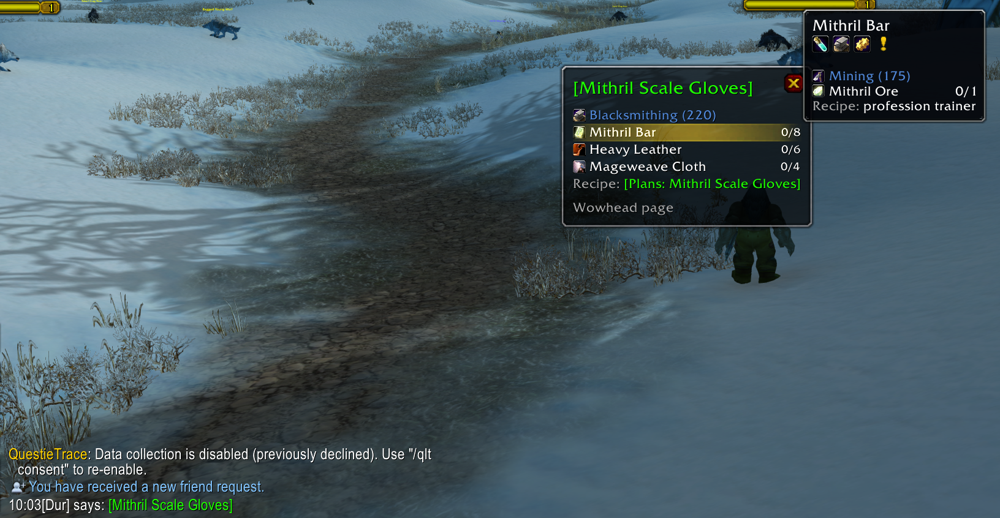

*Someone offers to craft a pair of gloves: Alt-click the link in chat, see the reagents, and hover the one you don't
know where to get.*

## What does it do?

### What an item is used for

Hold **Shift** (or Ctrl) over an item: the recipes it goes into, by profession and skill with how many of it each
takes, and the quests that ask for it, the completed ones marked.

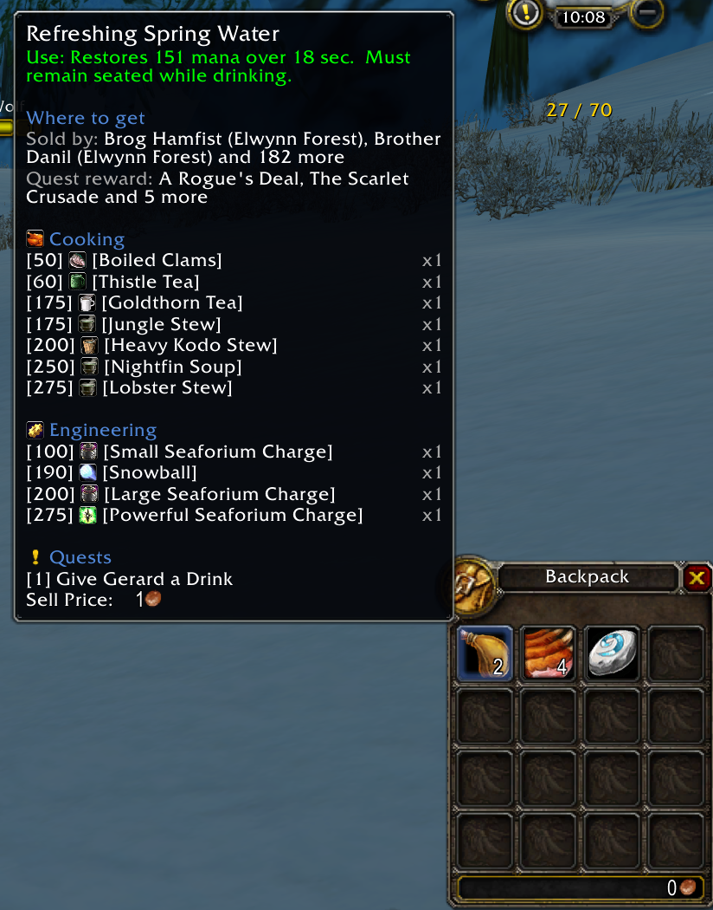

### Pinned windows

Hold **Alt** over an item to pin that list into a window that stays on screen. Hover a row for its tooltip, click it
for the item window, **Shift-click** to link it in chat. Long lists scroll; Escape closes them all.

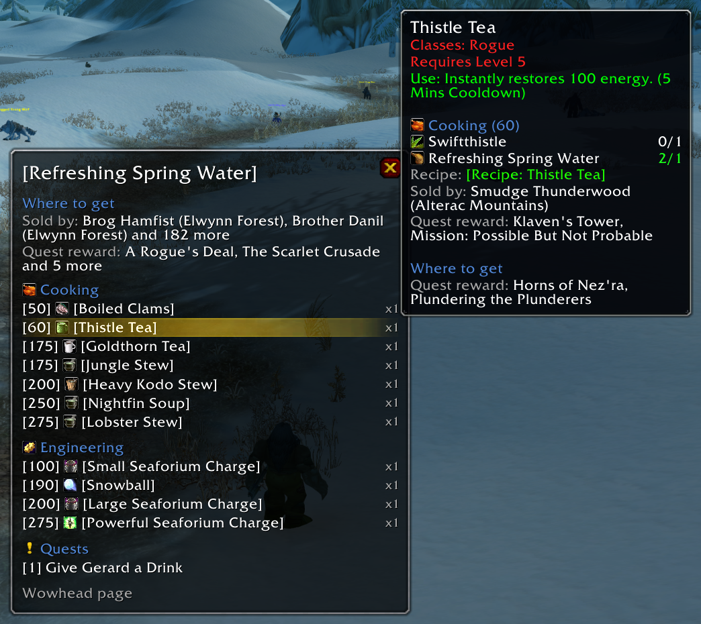

Alt over a row (or Alt-click, or a right click) opens a nested window beside it, as deep as you like: from a herb to
the elixir made of it to the belt made of that. An enchant opens the same way: what it does, what it takes and where
its formula comes from. A nested window closes with the one it came from, unless you drag it away: then it stays on
its own.

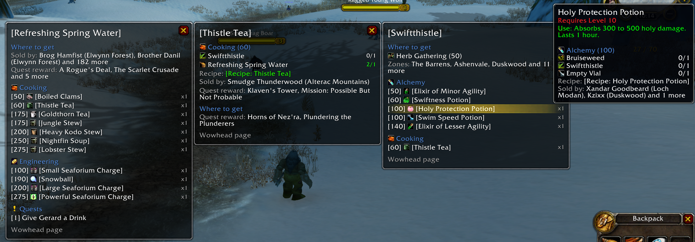

| An enchant | A window dragged away |
| --- | --- |
| 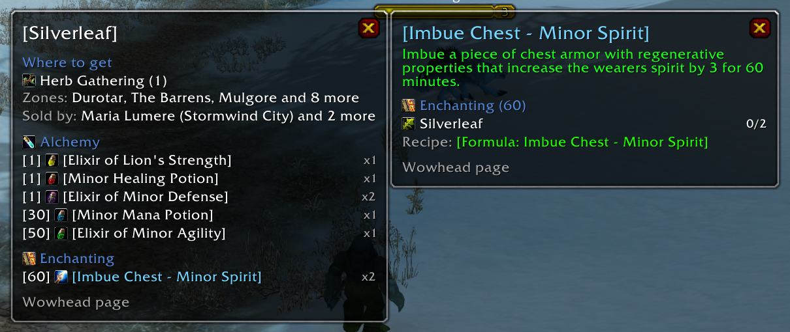 | 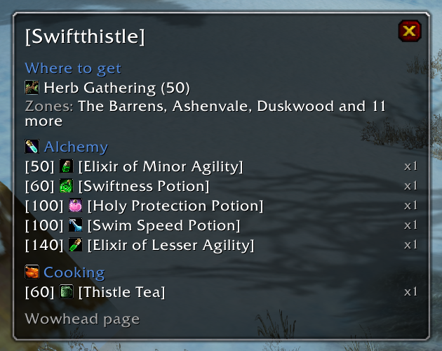 |

### Items from chat

**Alt-click** an item link in chat to pin it instead of opening the item window. A plain click opens the item window
as usual, with what the craft takes added and a reminder that Alt-click lets you open the reagents.

| Alt-click a link | A plain click |
| --- | --- |
| 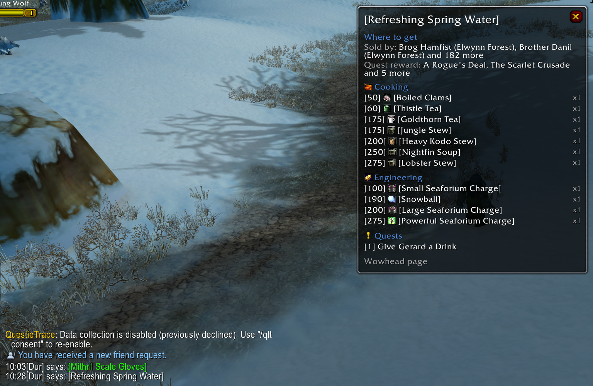 | 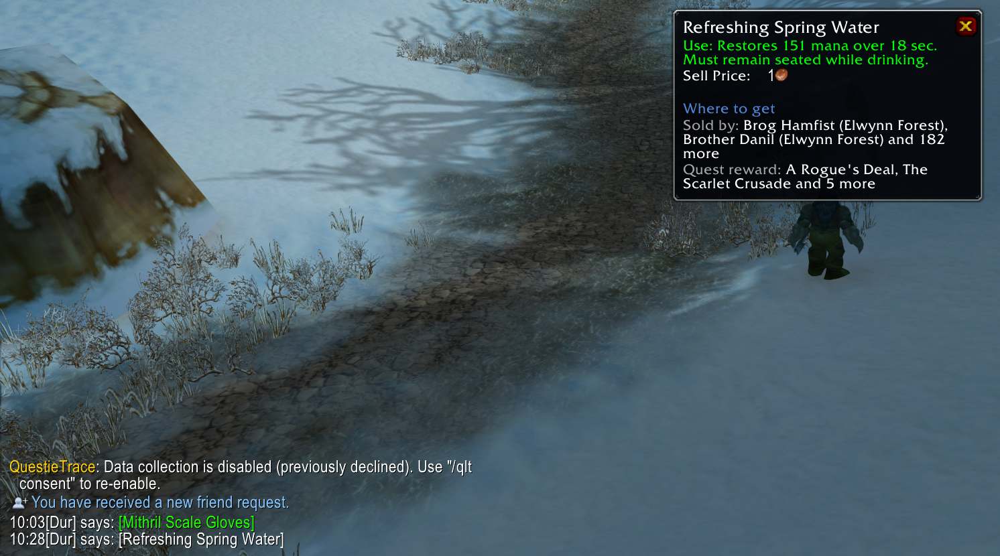 |

### What a craft takes

Pin a crafted item, hover it in a pinned window, click it, or hold Shift over it anywhere: the profession and skill
that make it, every reagent with how many you have (bags and bank) against how many it needs, and its recipe:
taught by the trainer, or the recipe item with who sells it and which quest rewards it. In a pinned window the
reagents open in nested windows like any other row, so you can follow an oil or a thread back to where it comes from.

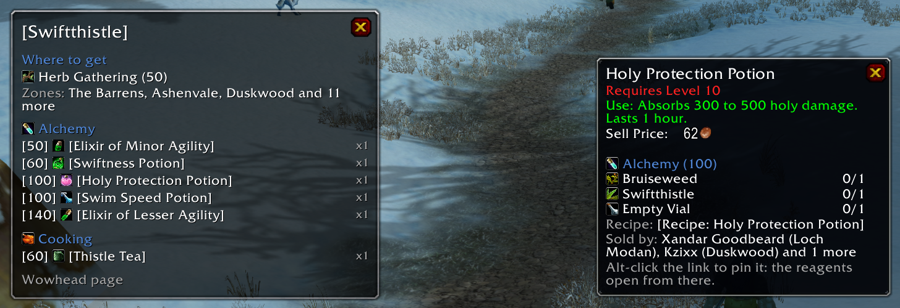

### Where to get it

The same places show where an item comes from. A herb, an ore or a stone shows the profession that gathers it with
the skill it needs and the zones where it grows most; leather and hides show the skinning skill they start at. Then
who sells the item and which quest rewards it. In a pinned window each of these lines is clickable and opens the
whole list: every vendor with their level and zone, every zone, the richest first.

| The zones of a herb | Every vendor |
| --- | --- |
| 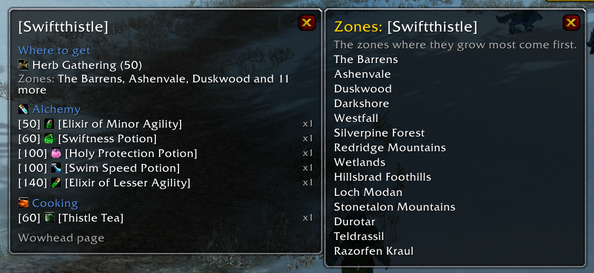 | 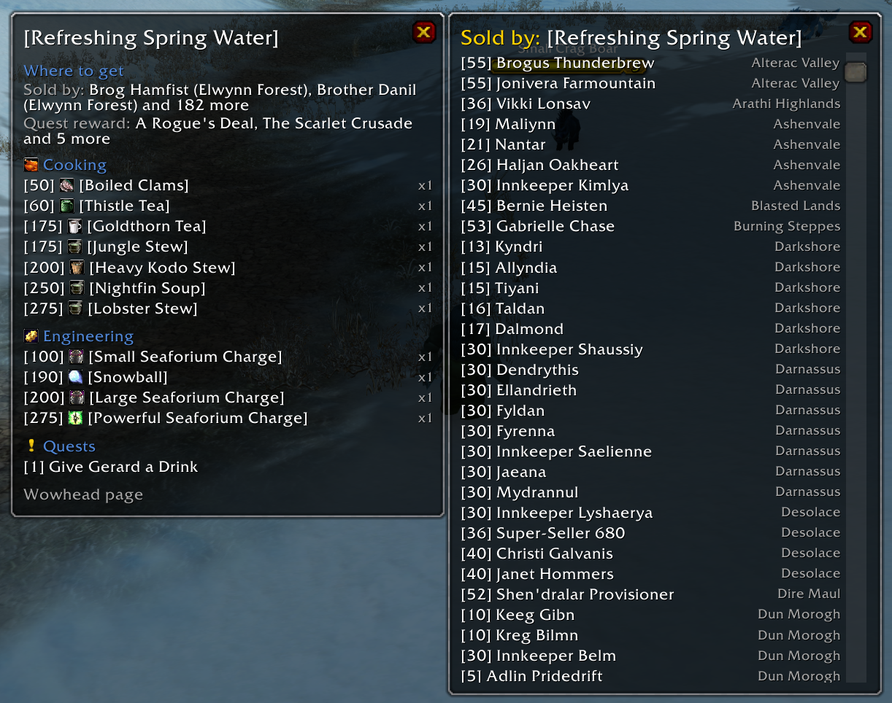 |

Craft Compass is a compass: it points you the right way, it isn't a database. It doesn't say which creatures drop an
item or which chests it is found in: the data addons have on that comes from private-server databases and is too
often wrong. For that, the last row of a pinned window is the item's (or the enchant's) Wowhead page: click it and
press Ctrl+C: the address is copied and the dialog closes (addons can't open a browser or copy by themselves). The page
is in your client's language where Wowhead has it (German, Spanish, French, Italian, Portuguese, Russian, Korean,
Simplified Chinese), in English otherwise, and on Wowhead's Classic or TBC site to match your game.

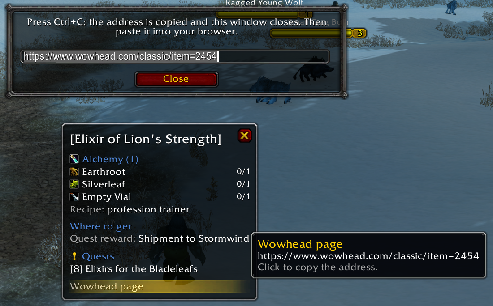

### And also

- **Quest windows.** Click a quest in a pinned window (or Alt over it) for its own window: level, zone and whether
  it's done, what it says to do, who gives it and who takes it back, the items to bring, the quests before and after
  it, and its Wowhead page. With Questie itself loaded, hovering a quest shows Questie's tooltip, and an "Open in
  Questie" row opens Questie's window of it.

  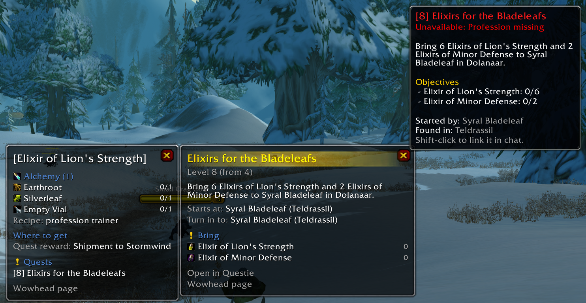

- **Quests in chat.** Shift-click a quest in a pinned window to link it in chat, in the `[Name (id)]` form Questie
  turns into a clickable quest link.
- **Any client language.** Everything is looked up by id, and item, quest, profession and zone names come in the
  client's language. The addon's own text is in English and Russian.

## Requirements

| Addon | | What it gives |
| --- | --- | --- |
| [AtlasLoot Classic](https://www.curseforge.com/wow/addons/atlaslootclassic) | required | Recipes, reagents and recipe items |
| [Questie](https://www.curseforge.com/wow/addons/questie) (QuestieDB) | optional | Quests and their windows, and where a recipe comes from |

Craft Compass carries no item data of its own: it reads them from these addons while the game runs, so it stays as
up to date as they are. Without Questie there are no quests and a recipe is shown without its sources.

**Works well with** [ItemTooltipProfessionIcons](https://www.curseforge.com/wow/search?search=ItemTooltipProfessionIcons) (optional): the row of profession icons in the
item tooltips on the screenshots comes from it. It shows at a glance which professions use an item; Craft
Compass adds the details with Shift or Alt.

## Installation

1. Install **AtlasLoot Classic** and, if you like, **Questie** (from the CurseForge app or their pages).
2. Download `CraftCompass-v<version>.zip` from the [latest release](https://github.com/ReSenpai/craft-compass/releases/latest)
   and unpack it into `World of Warcraft\_classic_era_\Interface\AddOns`. You should get the folder
   `Interface\AddOns\CraftCompass`.
3. Restart the game (or `/reload` if it is running) and check on the character screen, under AddOns, that Craft
   Compass and AtlasLoot Classic are enabled.

Settings: `/craftcompass` or `/ccompass`, or the AddOns tab of the game options.

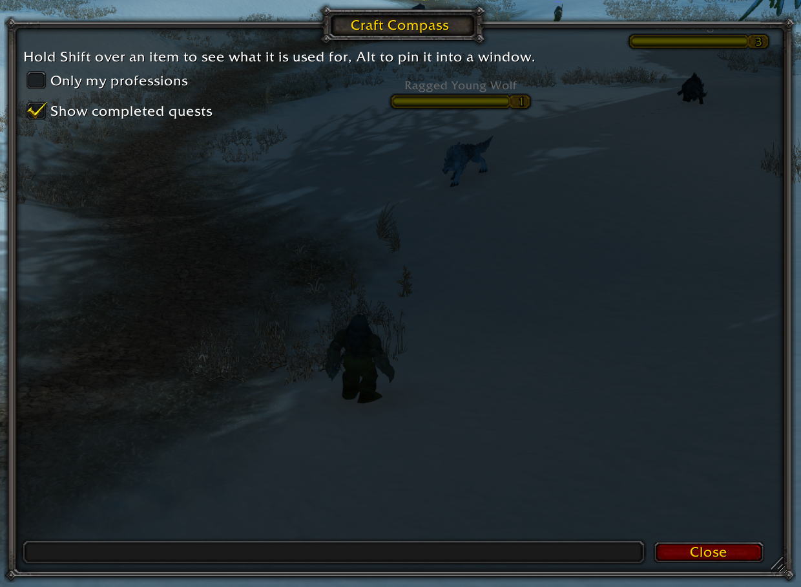

To remove it, delete the `Interface\AddOns\CraftCompass` folder.

## Compatibility

- **Classic Era** (1.15): `CraftCompass_Vanilla.toc`.
- **Burning Crusade Anniversary**: `CraftCompass_TBC.toc`.
- **Classic Forever**: `CraftCompass.toc`, as far as AtlasLoot and Questie support it.

Recipes are what AtlasLoot Classic knows about; Season of Discovery's own recipes aren't in it.

## How it works

- `Sources/AtlasLoot.lua` — after login, goes through AtlasLoot's crafts once in the background and indexes them by
  reagent and by created item.
- `Sources/Questie.lua` — the same for QuestieDB's quests, indexed by the items they ask for; quest, NPC and zone
  names.
- `Core/Lines.lua` — builds the lines for "what is this for" and "what does this craft take".
- `UI/Tooltip.lua` — the tooltip hooks; `UI/PinWindow.lua` — the pinned windows; `Core/Options.lua` — the settings.
- `Libs/` — the Ace3 libraries behind the options panel.

The details, with diagrams: [docs/ARCHITECTURE.md](docs/ARCHITECTURE.md).

Checks: `powershell -File tools/test.ps1` parses the Lua files, runs a smoke test against stubbed game and addon
APIs in English and Russian, and builds the craft index over an installed AtlasLoot Classic (needs Python with
`lupa` and `luaparser`, e.g. `pip install --target .tools/pylib lupa luaparser`).

Releases: raise `## Version` in the three TOC files and add a section for it to `CHANGELOG.md`; once that is on
`main`, `.github/workflows/release.yml` tags it and the [BigWigs packager](https://github.com/BigWigsMods/packager)
builds the zip and publishes it on GitHub (and on CurseForge). Pull requests are checked by
`.github/workflows/checks.yml`.

## License

Craft Compass is free software under the [GNU General Public License v3.0](LICENSE) or later; see [NOTICE](NOTICE)
for what it covers and the libraries it ships. Contributions are welcome, see [CONTRIBUTING](CONTRIBUTING.md).

Craft Compass is an unofficial fan project, not affiliated with or endorsed by Blizzard Entertainment.
