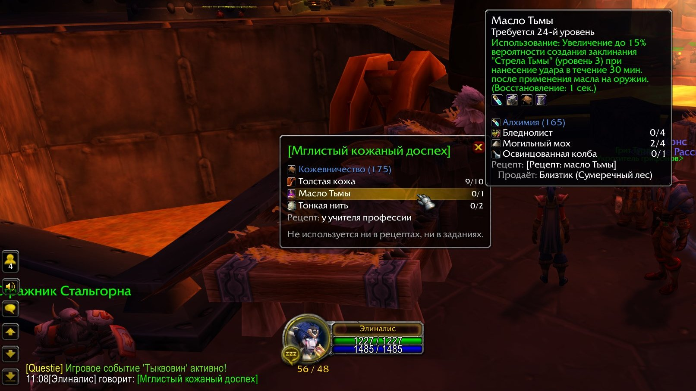
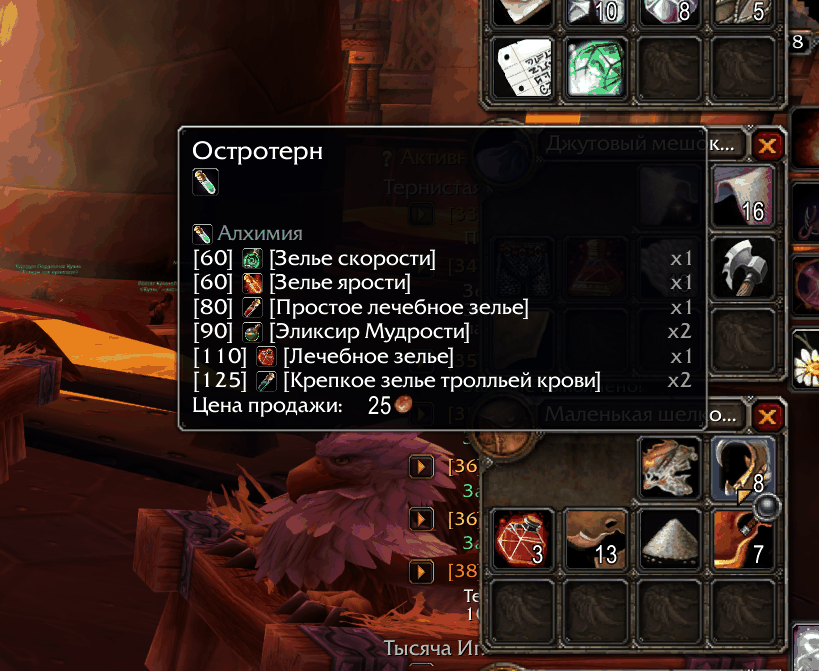
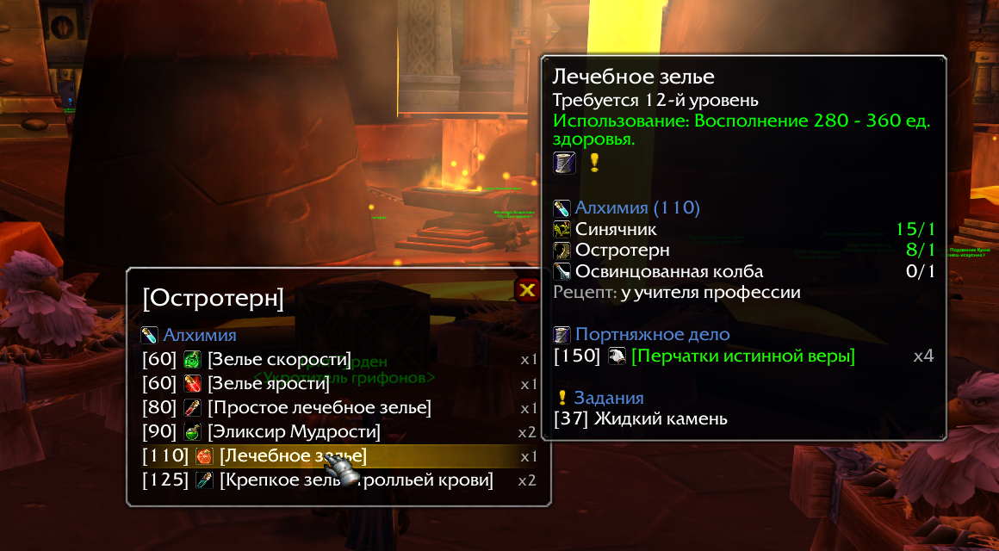
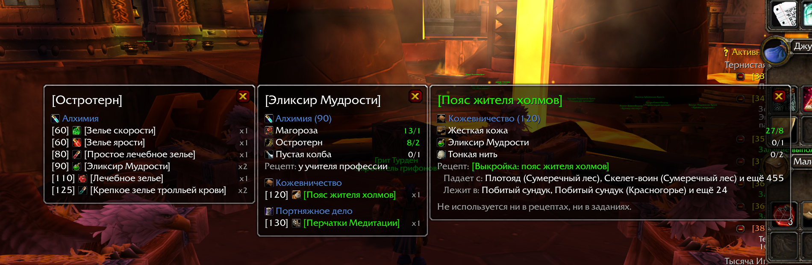
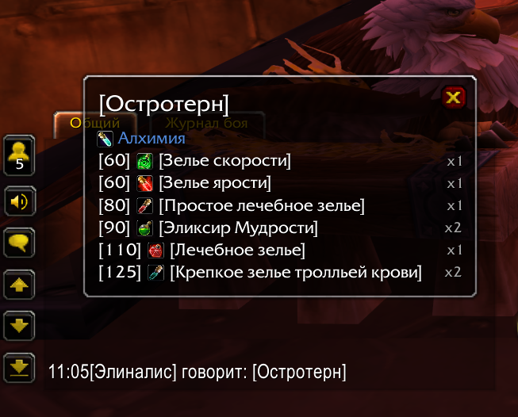
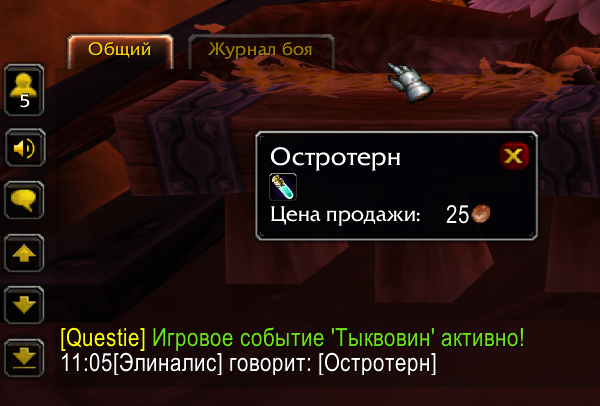
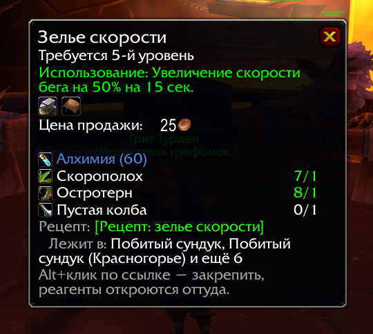

# Craft Compass

**Для чего нужен этот предмет и что нужно, чтобы его сделать? Подсказки и закреплённые окна для World of Warcraft
Classic.**

[English](README.md) · **Русский**

Наведите на траву, руду или ткань — и увидите все рецепты и задания, где она нужна. Закрепите этот список в окне,
посмотрите, для чего нужно уже само зелье из этой травы, а для любого крафтового предмета узнайте, какая профессия
его делает, какие реагенты нужны, сколько их уже у вас есть и где взять рецепт. Так понятно, что собрать, прежде чем
идти к мастеру с просьбой что-нибудь скрафтить.

[](#совместимость)
[](LICENSE)



*Вам предлагают скрафтить доспех: Alt+щелчок по ссылке в чате, и видны все реагенты, а наведение на незнакомый
показывает, откуда он берётся.*

## Что умеет

### Для чего нужен предмет

Зажмите **Shift** (или Ctrl) над предметом: рецепты, в которые он входит, по профессиям и уровню навыка, со
счётчиком «сколько штук нужно», и задания, где его просят. Выполненные задания помечены.



### Закреплённые окна

Зажмите **Alt** над предметом, и тот же список останется на экране в отдельном окне. Наведите на строку, чтобы
увидеть подсказку; щёлкните, чтобы открыть окно предмета; **Shift+щелчок** вставляет ссылку в чат. Длинные списки
прокручиваются, Escape закрывает все окна.



Alt над строкой (или Alt+щелчок, или правый щелчок) открывает рядом вложенное окно, и так сколько угодно глубоко: от
травы к эликсиру из неё и к поясу из эликсира.



### Предметы из чата

**Alt+щелчок** по ссылке на предмет в чате закрепляет его в окне вместо обычного окна предмета. Обычный щелчок
открывает окно предмета как всегда, но с тем, что нужно для крафта, и напоминанием, что Alt+щелчок позволит открыть
реагенты.

| Alt+щелчок по ссылке | Обычный щелчок |
| --- | --- |
|  |  |

### Что нужно для крафта

Закрепите крафтовый предмет, наведите на него в закреплённом окне, щёлкните по нему или зажмите Shift над ним где
угодно: профессия и навык, все реагенты (сколько есть у вас в сумках и банке и сколько нужно) и рецепт. Рецепт либо
учит учитель профессии, либо это предмет-рецепт, и тогда видно, кто его продаёт, с кого падает, где лежит и за какое
задание его дают. В закреплённом окне реагенты такие же строки, как остальные: их можно открыть во вложенном окне и
узнать, откуда берётся, например, масло или нитка.



### А ещё

- **Задания в чат.** Shift+щелчок по заданию в окне вставляет его в чат в виде `[Название (id)]`, а Questie
  превращает это в кликабельную ссылку на задание.
- **Любой язык клиента.** Всё ищется по id, поэтому названия предметов, заданий, профессий и зон приходят на языке
  клиента. Собственные надписи аддона на русском и английском.

## Что нужно для работы

| Аддон | | Что даёт |
| --- | --- | --- |
| [AtlasLoot Classic](https://www.curseforge.com/wow/addons/atlaslootclassic) | обязательно | Рецепты, реагенты и предметы-рецепты |
| [Questie](https://www.curseforge.com/wow/addons/questie) (QuestieDB) | по желанию | Задания и откуда берётся рецепт |

Своей базы предметов у Craft Compass нет: он читает данные из этих аддонов прямо во время игры, поэтому всегда
настолько свежий, насколько свежие они. Без Questie не будет заданий, а рецепт покажется без источников.

**Хорошо сочетается с** [ItemTooltipProfessionIcons](https://www.curseforge.com/wow/search?search=ItemTooltipProfessionIcons) (по желанию): ряд значков профессий в
подсказках предметов на скриншотах — от него. Он сразу показывает, каким профессиям нужен предмет, а Craft
Compass добавляет подробности по Shift или Alt.

## Установка

1. **AtlasLoot Classic** и, по желанию, **Questie** — из приложения CurseForge или вручную, с их страниц.
2. **Craft Compass.** Скачайте `CraftCompass-v<версия>.zip` из [последнего релиза](https://github.com/ReSenpai/craft-compass/releases/latest)
   и распакуйте в `World of Warcraft\_classic_era_\Interface\AddOns` — должна получиться папка
   `Interface\AddOns\CraftCompass` с файлом `CraftCompass_Vanilla.toc` внутри.
3. Перезапустите игру (или `/reload`, если она уже открыта) и проверьте, что в списке модификаций на экране выбора
   персонажа включены Craft Compass и AtlasLoot Classic.

В итоге в `Interface\AddOns` должно быть:

```
AtlasLootClassic, AtlasLootClassic_*   — AtlasLoot Classic
Questie                                 — Questie (по желанию)
CraftCompass                            — Craft Compass
```

### Как пользоваться

| Что сделать | Что получится |
| --- | --- |
| Shift (или Ctrl) над предметом | В подсказке — рецепты и задания, где он нужен; для крафтового — что нужно для крафта |
| Alt над предметом | Тот же список в закреплённом окне |
| Alt+щелчок по ссылке на предмет в чате | То же окно для предмета из ссылки |
| Наведение на строку окна | Подсказка предмета, задания или крафта |
| Щелчок по строке | Окно предмета |
| Shift+щелчок по строке | Ссылка на предмет или задание в чат |
| Alt над строкой, Alt+щелчок или правый щелчок | Вложенное окно рядом |
| Escape или крестик | Закрыть окна (вместе с вложенными) |

### Настройки

`/craftcompass` или `/ccompass`, либо «Параметры» → «Модификации» → Craft Compass:

- **Только мои профессии** — рецепты только тех профессий, что есть у персонажа.
- **Показывать выполненные задания** — с пометкой «выполнено».
- **Строка «не используется»** — писать, если предмет не нужен ни в одном рецепте или задании.

### Если что-то не работает

- Ничего не появляется по Shift — проверьте, что включён AtlasLoot Classic: без него аддон не загрузится.
- Нет заданий — поставьте Questie.
- Включите показ ошибок `/console scriptErrors 1` и пришлите текст ошибки в
  [issues](https://github.com/ReSenpai/craft-compass/issues) — с версиями Craft Compass, AtlasLoot и Questie.

### Удаление

Закройте игру и удалите папку `Interface\AddOns\CraftCompass`. Настройки хранятся в
`WTF\Account\<аккаунт>\SavedVariables\CraftCompass.lua` — его тоже можно удалить.

## Совместимость

- **Classic Era** (1.15) — `CraftCompass_Vanilla.toc`.
- **Burning Crusade Anniversary** — `CraftCompass_TBC.toc`.
- **Classic Forever** — `CraftCompass.toc`, насколько её поддерживают AtlasLoot и Questie.
- **Язык клиента** — любой; надписи аддона на русском и английском, на остальных языках — на английском.

Рецепты — те, что знает AtlasLoot Classic; собственных рецептов Season of Discovery в нём нет.

## Лицензия

Craft Compass — свободная программа под [GNU General Public License v3.0](LICENSE) или более поздней версии; что
под неё попадает и какие библиотеки идут в комплекте — в [NOTICE](NOTICE). Помощь приветствуется, см.
[CONTRIBUTING](CONTRIBUTING.md) (на английском).

Craft Compass — неофициальный фанатский проект, не связанный с Blizzard Entertainment и не одобренный ею.
