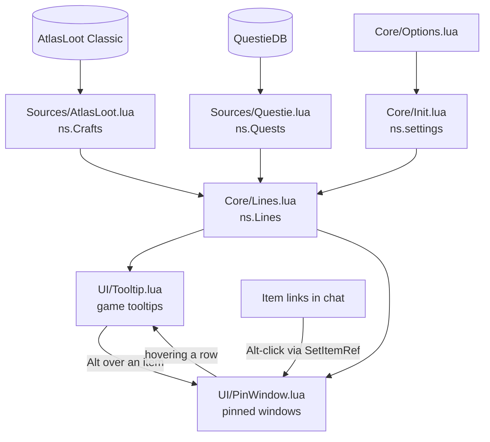
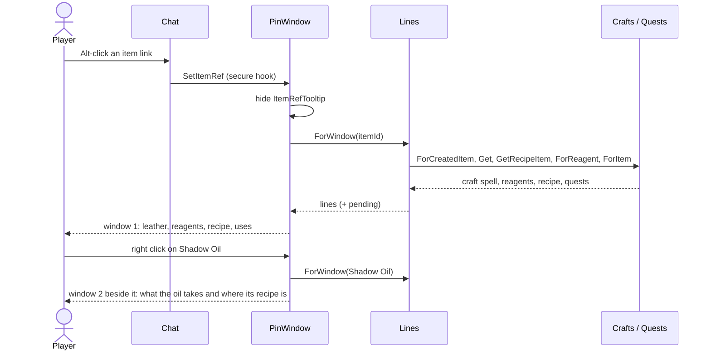

# Craft Compass architecture

**English** · [Русский](ARCHITECTURE.ru.md) · [README](../README.md)

How the addon is put together: where its data comes from, how a tooltip or a pinned window gets its lines, and what
happens on each click. For setting up the repository and running the checks, see [CONTRIBUTING.md](../CONTRIBUTING.md).

## Principles

- **No data of its own.** Crafts come from AtlasLoot Classic (required), quests and recipe sources from QuestieDB
  (optional, part of Questie). Both are read while the game runs. Craft Compass only indexes them and calls their
  public functions, so it is as complete and up to date as they are.
- **Everything by id.** Items, spells, quests, NPCs and zones are looked up by id, never by name. That is why the
  addon works on any client language: names come from the client or from QuestieDB in that language.
- **One line model, two ways to draw it.** The text is built once as a list of lines (`Core/Lines.lua`) and then drawn
  either into the game tooltip or into a pinned window.
- **Don't freeze the game.** Indexes are built in the background after login, spread over frames. If they are needed
  sooner, the rest is finished on the spot.
- **Names arrive late.** Items the client hasn't cached have no name yet. Such lines are drawn as `...` and marked
  *pending*, and are drawn again once the server sends the names.

## Modules

The files load in the order the TOC lists them. Each one is a module on the shared addon namespace
(`local _, ns = ...`) and may use only the modules loaded before it.

| File | Module | What it does |
| --- | --- | --- |
| `Libs/Libs.xml` | — | Ace3: LibStub, CallbackHandler, AceGUI, AceConfig (options panel only). |
| `Core/Init.lua` | `ns.L`, `ns.settings`, `ns.OnLogin` | Namespace, string table, saved settings, login callbacks. |
| `Locales/enUS.lua`, `ruRU.lua` | fills `ns.L` | The addon's own text. A missing key shows as the key itself. |
| `Core/Util.lua` | `ns.Util` | Wrappers over the client API, `SafeCall`, link parsing, `RunInBackground`. |
| `Sources/AtlasLoot.lua` | `ns.Crafts` | Crafts: reagent → craft spells, created item → craft spell, recipe items. |
| `Sources/Questie.lua` | `ns.Quests` | Quests by item, quest/NPC/zone names, recipe sources, chat links. |
| `Core/Lines.lua` | `ns.Lines` | Builds the lines: what an item is used for, what a craft takes. |
| `UI/PinWindow.lua` | `ns.PinWindow` | Pinned windows, nested windows, chat Alt-click. |
| `UI/Tooltip.lua` | `ns.Tooltip` | Tooltip hooks, modifier keys, redrawing when names arrive. |
| `Core/Options.lua` | — | Options panel and `/craftcompass`, `/ccompass`. |

## Start-up

1. `ADDON_LOADED` for Craft Compass: the saved variable `CraftCompassDB` becomes `ns.settings`, with defaults for
   missing keys (`onlyMyProfessions = false`, `showCompletedQuests = true`, `showNotUsed = true`).
2. `PLAYER_LOGIN`: every callback registered with `ns.OnLogin` runs, in load order. By then all addons, AtlasLoot
   and QuestieDB included, are loaded.
   - `Crafts` and `Quests` start building their indexes in the background, if their source addon is there.
   - `Tooltip` hooks `GameTooltip` and `ItemRefTooltip`.
   - `Options` registers the options panel and the slash commands.

`Util.RunInBackground(work)` runs `work` as a coroutine, resumed once per frame by `C_Timer.NewTicker(0)`. `work`
yields every so often. It returns a *finish* function that runs the rest at once. `Crafts.ForReagent`,
`Crafts.ForCreatedItem` and `Quests.ForItem` call it first, so a tooltip shown right after login is still complete.

## Data sources

### Crafts (`Sources/AtlasLoot.lua`)

AtlasLoot stores crafts in a private table and looks them up only by spell id:

- `AtlasLoot.Data.Profession.GetProfessionData(spellId)` →
  `{createdItemId, professionId, minSkill, lowSkill, highSkill, reagentIds, reagentCounts, numCreated}`
- `AtlasLoot.Data.Recipe.GetRecipeForSpell(spellId)` → the recipe item, or nil when a trainer teaches it.

To find crafts *by item*, the index goes over spell ids 1 to 400 000 once (Classic Era crafts end near 30 000, TBC
near 51 000, and the Anniversary client added a few near 351 000). It yields every 10 000 ids; the whole pass takes
about 11 ms. It builds two tables:

- `spellsByReagent[itemId]` — the craft spells that use the item;
- `spellByCreatedItem[itemId]` — the craft spell that makes the item (the first one found).

Profession names and icons come from a fixed spell per AtlasLoot profession id (Alchemy → spell 2259 and so on),
so they are in the client's language.

### Quests (`Sources/Questie.lua`)

QuestieDB answers `LibQuestieDB.<Quest|Item|Npc|Object>.Get(id, field)` and `Quest.GetAllIds()`. It knows which items
a quest asks for, but not which quests ask for an item, so that index is built in the background too, 250 quests per
step. It takes items from:

- `objectives[3]` — the items to bring, `{{itemId, text, count}, ...}`;
- `requiredSourceItems` — items the quest needs in the bags.

`Quests.IsForPlayer` checks `requiredRaces` and `requiredClasses`, bit masks with the flag `2^(id-1)`. They are
checked with arithmetic: Lua 5.1 has no bit operators, and the client's `bit.band` stops at 32 bits.

QuestieDB also provides recipe sources (`Item` fields `vendors`, `npcDrops`, `objectDrops`, `questRewards`), NPC
faction (`friendlyToFaction`: `"A"`, `"H"`, `"AH"`) and zones (`zoneID`, `zoneOrSort`, named through
`C_Map.GetAreaInfo`).

Without QuestieDB there are no quests, and recipes are shown without their sources. Calls into other addons go
through `Util.SafeCall`, so a change in their API doesn't break tooltips.

## The line model (`Core/Lines.lua`)

A line is a table:

| Field | Meaning |
| --- | --- |
| `text` | left text (may hold an inline icon and a link) |
| `color` | `{r, g, b}` of the left text, white by default |
| `right`, `rightColor` | right text and its colour (`x4`, `3/4`) |
| `link` | the item or spell link the line stands for; in a pinned window the row becomes clickable |
| `quest` | the quest id the line stands for |
| `wrap` | let a long text wrap in tooltips |
| `spacer` | an empty line between sections |

Builders return `lines, pending`, where `pending` means some item names weren't cached yet:

- `Lines.ForItemUses(itemId)` — the recipes the item goes into, grouped by profession (sorted by name), each sorted by
  skill, with the reagent count. Then the quests that ask for it, for this race and class, sorted by level, completed
  ones marked. Settings filter both. When there is nothing, it adds the "not used" line.
- `Lines.ForCraft(spellId)` — profession and skill, each reagent with *have/need* (bags and bank, green when enough),
  then the recipe: "trainer", or the recipe item with up to two vendors (the player's faction first), drops,
  containers and quest rewards, plus "and N more".
- `Lines.ForWindow(itemId)` — for a pinned window: `ForCraft` of the item's craft, if it is crafted, followed by
  `ForItemUses`. Reagents are ordinary rows with links, so they open like any other item.
- `Lines.AddToTooltip(tooltip, lines)` — draws lines with `AddLine` / `AddDoubleLine`.

## Tooltips (`UI/Tooltip.lua`)

Classic clients call `OnTooltipSetItem` (they have `TooltipDataProcessor`, but don't call it). So the addon hooks
`OnTooltipSetItem` on `GameTooltip` (hover) and `ItemRefTooltip` (the item window a link click opens). Comparison and
other tooltips are left alone. `TooltipDataProcessor` is used only on a client without that script.

What gets added:

| Situation | Craft (`ForCraft`) | Uses (`ForItemUses`) | Other |
| --- | --- | --- | --- |
| Hover, no modifier | — | — | — |
| Hover with **Shift** or **Ctrl** | if crafted | yes | — |
| Hover with **Alt** | — | — | opens pinned window, level 1 |
| Hover a row of a pinned window | if crafted | with Shift | Alt opens a nested window |
| Item window (`ItemRefTooltip`) | if crafted | — | hint: Alt-click the link to pin it |

- **Modifier keys:** `MODIFIER_STATE_CHANGED` calls the `OnEnter` of the hovered tooltip's owner again. Pressing or
  releasing Shift or Alt over an item then redraws without moving the mouse.
- **Pinned rows** carry `craftCompassLevel`. A tooltip whose owner has it belongs to a pinned window, at that level.
- **Enchants and spells** don't go through the item hook. `Tooltip.AddCraftToSpellTooltip` adds their craft to a
  pinned row's tooltip.

## Pinned windows (`UI/PinWindow.lua`)

Windows are frames `CraftCompassWindow1`, `CraftCompassWindow2`, … by nesting level. They are created on first use
and reused after that. Level 1 is opened from a tooltip or from chat; level *n + 1* from a row of level *n*.

- **Layout:** the title is the item link itself (a row, so it can be hovered and clicked), and below it a scroll
  frame of rows. The width fits the longest row. The height stops at 60% of the screen; past that the list scrolls
  (mouse wheel or the bar).
- **Placement:** level 1 opens in the centre and stays where the player dragged it. A nested window opens beside its
  parent, on the side with room.
- **Closing:** hiding a window hides the next level, so closing one closes everything nested in it. Escape closes
  them (the windows are in `UISpecialFrames`). The close button calls `window:Hide()` directly. The standard button
  goes through `HideUIPanel`, which is blocked in combat.
- **Same item again:** Alt over the item already shown keeps the window as it is (position, scroll, nested windows).

What a row does:

| Action | Item or reagent row | Quest row |
| --- | --- | --- |
| Hover | its tooltip (item tooltip with its craft, or quest name, level, zone) | quest tooltip |
| Click | item window (`SetItemRef`) | — |
| Shift-click | link in chat | `[Name (id)]` in chat, which Questie makes a quest link |
| Right click, Alt-click, Alt over it | nested window one level deeper | — |

**Items from chat:** `hooksecurefunc("SetItemRef", ...)` sees every link click: chat, quest log and anything else
that goes through `SetItemRef`. With Alt held on an `item:` link, the addon opens a level 1 window for it and
hides the item window the click opened. A secure hook runs after the original and doesn't taint it.

## Names that arrive late

`GetItemInfo` returns nothing for items the client hasn't seen yet, and asks the server for them. Builders then mark
their lines `pending`:

- a pinned window keeps `window.pending`;
- `Tooltip` keeps a `pending[tooltip]` flag, which `OnTooltipCleared` resets.

On `GET_ITEM_INFO_RECEIVED` (names come in bursts, so it waits 0.2 s once for the burst), the addon redraws:

- pending windows, in place: position, scroll and nested windows stay;
- the hovered tooltip, by entering its owner again;
- the item window, through `SetHyperlink`.

## Example: an item from chat

Someone links leather armour in chat, and the player Alt-clicks it.

## Settings and text

- `ns.settings` reads through to the defaults. `Core/Options.lua` builds an AceConfig table of three toggles, adds it
  to the game options (AddOns) and opens it with `/craftcompass` or `/ccompass`. Lines are built on every show, so a
  change applies to the next tooltip.
- Every string the player sees goes through `ns.L`. `enUS.lua` fills it and `ruRU.lua` overrides it on a Russian
  client. Item, quest, profession and zone names already come in the client's language.

## Clients

One code base, three TOC files for the client flavours:

| TOC | Interface | Client |
| --- | --- | --- |
| `CraftCompass_Vanilla.toc` | 11509 | Classic Era 1.15 |
| `CraftCompass_TBC.toc` | 20506 | Burning Crusade Anniversary |
| `CraftCompass.toc` | 16001 | Classic Forever |

The API differences between them sit in `Util` (`C_Item` / `C_Spell` vs. the global functions).

## Checks and releases

- `tools/test.ps1` runs four checks:
  - `tests/check_syntax.py` — syntax of every Lua file;
  - `tools/release_check.py` — the versions in the three TOC files and the CHANGELOG agree;
  - `tests/smoke.py` (enUS and ruRU) — loads the addon in Lua (lupa) over stubs of the client, AtlasLoot and
    QuestieDB and goes through tooltips, windows, nesting, chat Alt-click and closing;
  - `tests/atlasloot_index.py` — builds the craft index over the real data of an installed AtlasLoot Classic.
- `.github/workflows/release.yml` — a push to `main` with a new `## Version` (and a CHANGELOG section for it):
  runs the checks, tags `v<version>` and builds the zip with the BigWigs packager. The zip goes to a GitHub Release,
  and to CurseForge once the project is set up there. `.pkgmeta` keeps `docs/`, `tests/`, `tools/` and the
  repository files out of the zip.
- `checks.yml` runs the same checks on pull requests, plus gitleaks.
