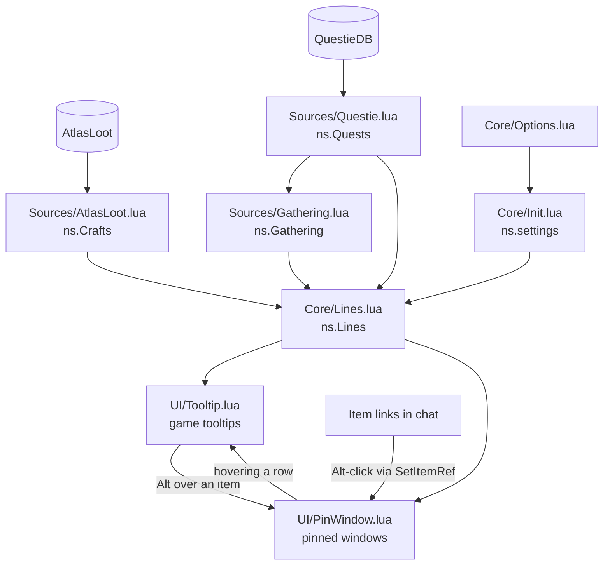
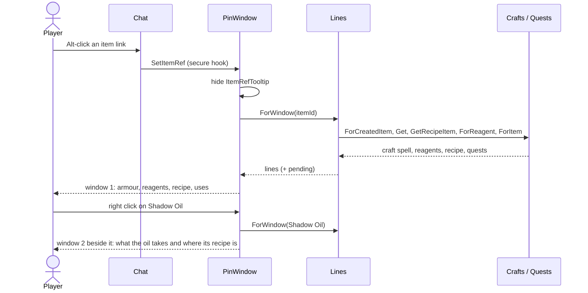

# Craft Compass architecture

**English** · [Русский](ARCHITECTURE.ru.md) · [README](../README.md)

How the addon is put together: where its data comes from, how a tooltip or a pinned window gets its lines, and what
happens on each click. For setting up the repository and running the checks, see [CONTRIBUTING.md](../CONTRIBUTING.md).

## Principles

- **No data of its own.** Crafts come from AtlasLoot (required: AtlasLoot Continued, or AtlasLoot Classic and its
  fork), quests and recipe sources from QuestieDB
  (optional, part of Questie). Both are read while the game runs. Craft Compass only indexes them and calls their
  public functions, so it is as complete and up to date as they are.
- **Everything by id.** Items, spells, quests, NPCs and zones are looked up by id, never by name. That is why the
  addon works on any client language: names come from the client or from QuestieDB in that language.
- **One line model, two ways to draw it.** The text is built once as a list of lines (`Core/Lines.lua`) and then drawn
  either into the game tooltip or into a pinned window.
- **Don't freeze the game.** Indexes are built in the background after login, spread over frames. If they are needed
  sooner, the rest is finished on the spot.
- **Names arrive late.** Items the client hasn't cached have no name yet. Such lines are drawn as `...` and marked
  *pending*, and are drawn again once the server sends the names.

## Modules

The files load in the order the TOC lists them. Each one is a module on the shared addon namespace
(`local _, ns = ...`) and may use only the modules loaded before it.

| File | Module | What it does |
| --- | --- | --- |
| `Libs/Libs.xml` | — | Ace3: LibStub, CallbackHandler, AceGUI, AceConfig (options panel only). |
| `Core/Init.lua` | `ns.L`, `ns.settings`, `ns.OnLogin` | Namespace, string table, saved settings, login callbacks. |
| `Locales/enUS.lua`, `ruRU.lua` | fills `ns.L` | The addon's own text. A missing key shows as the key itself. |
| `Core/Util.lua` | `ns.Util` | Wrappers over the client API, `SafeCall`, link parsing, `RunInBackground`. |
| `Sources/AtlasLoot.lua` | `ns.Crafts` | Crafts: reagent → craft spells, created item → craft spell, recipe items. |
| `Sources/Questie.lua` | `ns.Quests` | Quests by item, quest/NPC/zone names, item sources, chat links. |
| `Sources/Gathering.lua` | `ns.Gathering` | Gathered resources: profession, skill, zones of their herbs and veins. |
| `Core/Lines.lua` | `ns.Lines` | Builds the lines: what an item is used for, what a craft takes, where an item comes from. |
| `UI/PinWindow.lua` | `ns.PinWindow` | Pinned windows, nested windows, chat Alt-click. |
| `UI/Tooltip.lua` | `ns.Tooltip` | Tooltip hooks, modifier keys, redrawing when names arrive. |
| `Core/Options.lua` | — | Options panel and `/craftcompass`, `/ccompass`. |

## Start-up

1. `ADDON_LOADED` for Craft Compass: the saved variable `CraftCompassDB` becomes `ns.settings`, with defaults for
   missing keys (`onlyMyProfessions = false`, `showCompletedQuests = true`).
2. `PLAYER_LOGIN`: every callback registered with `ns.OnLogin` runs, in load order. By then all addons, AtlasLoot
   and QuestieDB included, are loaded.
   - `Crafts`, `Quests` and `Gathering` start building their indexes in the background, if their source addon is
     there.
   - `Tooltip` hooks `GameTooltip` and `ItemRefTooltip`.
   - `Options` registers the options panel and the slash commands.

`Util.RunInBackground(work)` runs `work` as a coroutine, resumed once per frame by `C_Timer.NewTicker(0)`. `work`
yields every so often. It returns a *finish* function that runs the rest at once. `Crafts.ForReagent`,
`Crafts.ForCreatedItem`, `Quests.ForItem` and the `Gathering` lookups call it first, so a tooltip shown right after login is still complete.

## Data sources

### Crafts (`Sources/AtlasLoot.lua`)

AtlasLoot comes in three builds that share the global `AtlasLoot` and these functions: AtlasLoot Continued (folder
`AtlasLootContinued`), the maintained AtlasLoot Classic fork and the original AtlasLoot Classic (both in the folder
`AtlasLootClassic`). So the TOC names both folders under `OptionalDeps`, which only makes them load first: with
`Dependencies` the game would refuse to load Craft Compass without the one folder named. Without any of them,
`Crafts.IsAvailable()` is false, there is no craft index, and a line in chat says so at login. Both folders enabled
at once break each other (one global), so that gets a line in chat too.

AtlasLoot stores crafts in a private table and looks them up only by spell id:

- `AtlasLoot.Data.Profession.GetProfessionData(spellId)` →
  `{createdItemId, professionId, minSkill, lowSkill, highSkill, reagentIds, reagentCounts, numCreated}`
- `AtlasLoot.Data.Recipe.GetRecipeForSpell(spellId)` → the recipe item, or nil when a trainer teaches it.

To find crafts *by item*, the index goes over spell ids 1 to 400 000 once (Classic Era crafts end near 30 000, TBC
near 51 000, and the Anniversary client added a few near 351 000). The maintained AtlasLoot fork keeps Season of
Discovery's recipes, from about 426 000 to 1 232 000, in the same table as Classic Era's, so on a Season of Discovery
realm (`C_Seasons.GetActiveSeason()`) the pass goes on to 1 300 000, and elsewhere they stay out. It yields every
25 000 ids; the whole pass takes about 11 ms, a few dozen on Season of Discovery. It builds two tables:

- `spellsByReagent[itemId]` — the craft spells that use the item;
- `spellByCreatedItem[itemId]` — the craft spell that makes the item (the first one found).

Profession names and icons come from a fixed spell per AtlasLoot profession id (Alchemy → spell 2259 and so on),
so they are in the client's language.

### Quests (`Sources/Questie.lua`)

QuestieDB answers `LibQuestieDB.<Quest|Item|Npc|Object>.Get(id, field)` and `Quest.GetAllIds()`. It knows which items
a quest asks for, but not which quests ask for an item, so that index is built in the background too, 250 quests per
step. It takes items from:

- `objectives[3]` — the items to bring, `{{itemId, text, count}, ...}`;
- `requiredSourceItems` — items the quest needs in the bags.

`Quests.IsForPlayer` checks `requiredRaces` and `requiredClasses`, bit masks with the flag `2^(id-1)`. They are
checked with arithmetic: Lua 5.1 has no bit operators, and the client's `bit.band` stops at 32 bits.

QuestieDB also provides where items come from (`Item` fields `vendors` and `questRewards`), NPC
faction (`friendlyToFaction`: `"A"`, `"H"`, `"AH"`), NPC level (`minLevel`, `maxLevel`) and zones (`zoneID`,
`zoneOrSort`, named through `C_Map.GetAreaInfo`). An NPC or object shows its main zone and then the other zones of
its `spawns`: the Darkmoon Faire's vendors have `zoneID` Mulgore, but stand in Elwynn Forest too.

Its drop fields (`npcDrops`, `objectDrops`, `itemDrops`) are not used on purpose. Questie fills them from Wowhead
only for quest items; the rest come from an emulator's database (CMaNGOS) and are often wrong: rogue quest mobs
"dropping" herbs at 21%, for one. The pinned window links the item's Wowhead page instead.

A quest's window reads more of its fields: `objectivesText` (what it says to do, translated by QuestieDB),
`startedBy` and `finishedBy` (`{npcIds, objectIds, itemIds}`), `requiredLevel`, `preQuestSingle` and `preQuestGroup`
(the quests before it) and `nextQuestInChain`.

With Questie itself loaded and started (`Questie.started`), two of its own modules are used through
`QuestieLoader:ImportModule`: `QuestieLink:CreateQuestTooltip(link, tooltip)` for a quest row's tooltip
(`Quests.AddQuestieTooltip`) and `QuestieSearchResults:GetDetailFrame("quest", id)` for Questie's window of a quest
(`Quests.OpenInQuestie`). They aren't Questie's public API, so each call checks the function is there and goes through
`SafeCall`; without them the row shows its own short tooltip and the window has no "Open in Questie" row.

Without QuestieDB there are no quests, and items and recipes are shown without their sources. Calls into other addons go
through `Util.SafeCall`, so a change in their API doesn't break tooltips.

### Gathering (`Sources/Gathering.lua`)

Neither AtlasLoot nor QuestieDB knows which skill a herb, a vein or a hide needs, so this is the one table of game
facts the addon keeps itself:

- `NODES` — herbs and veins by their English name: profession and skill (Dreamfoil → Herbalism 270);
- `ITEM_NODES` — which of them each resource comes from (Thorium Ore and Dense Stone → the four thorium veins);
- `SKINNED` — leather and hides with the skinning skill beasts start to give them at.

QuestieDB has the herbs and veins as objects with their spawn points, but doesn't link herbs to the items they
give. So after login the index goes over every object once (250 per step) and keeps those whose raw name
(`Object.GetRaw`, English on every client) is in `NODES`. `Gathering.GetZones` adds up their spawn points by zone
and sorts the zones, most points first; the counts only set the order and are not shown, since they come from an
emulator's database and don't match the live realms. The spawn points are read with `GetRaw` too: Questie's corrections clear
them for the 24 most common herbs and veins (Briarthorn, copper...), which it never draws on the map.

## The line model (`Core/Lines.lua`)

A line is a table:

| Field | Meaning |
| --- | --- |
| `text` | left text (may hold an inline icon and a link) |
| `color` | `{r, g, b}` of the left text, white by default |
| `right`, `rightColor` | right text and its colour (`x4`, `3/4`) |
| `link` | the item or spell link the line stands for; in a pinned window the row becomes clickable |
| `open` | a list a click opens in a nested window: `{kind, itemId, label}`, built by `Lines.ForList` |
| `url` | a web page a click offers to copy (a Wowhead page) |
| `action`, `hint` | a function a click calls, and its tooltip text ("Open in Questie") |
| `quest` | the quest id the line stands for |
| `wrap` | let a long text wrap: tooltips wrap it, pinned windows wrap it at a set width |
| `spacer` | an empty line between sections |

Builders return `lines, pending`, where `pending` means some item names weren't cached yet:

- `Lines.ForItemUses(itemId)` — the recipes the item goes into, grouped by profession (sorted by name), each sorted by
  skill, with the reagent count. Then the quests that ask for it, for this race and class, sorted by level, completed
  ones marked. Settings filter both. When there is nothing, it says nothing: the sources don't know every use.
- `Lines.ForCraft(spellId)` — profession and skill, each reagent with *have/need* (bags and bank, green when enough),
  then the recipe: "trainer", or the recipe item with up to two vendors (the player's faction first) and quest
  rewards, plus "and N more".
- `Lines.ForSources(itemId)` — "where to get": the gathering profession with its skill and the top three zones,
  then vendors and quest rewards from QuestieDB. Each list names two and adds "and N more"; names are looked up
  only for those two.
- `Lines.ForList(open)` — the whole list behind a source line: vendors (the other faction last, greyed out),
  quests, or every zone, the richest first.
- `Lines.ForOrigin(itemId)` — `ForCraft` of the item's craft, if it is crafted, followed by `ForSources`.
- `Lines.ForWindow(itemId)` — for a pinned window: `ForOrigin`, then `ForItemUses`, then the item's Wowhead page
  (`Util.WowheadUrl`: `classic` or `tbc` by the client's interface version, and its language folder). Reagents
  are ordinary rows with links, so they open like any other item.
- `Lines.ForSpellWindow(spellId)` — for a pinned window of a craft that makes no item (an enchant): the spell's
  description, `ForCraft`, and the spell's Wowhead page. A description the client hasn't loaded yet is asked for
  (`Util.LoadSpell`), and the window is drawn again once it arrives.
- `Lines.ForQuestWindow(questId)` — for a pinned window of a quest: level (and the level it opens from), zone and
  whether it is completed or in the log (`Util.IsQuestInLog`), `objectivesText`, who gives and takes it back, the
  items to bring as item rows with "have/need", the quests before and after it as quest rows, "Open in Questie" when
  Questie is there, and the quest's Wowhead page.
- `Lines.AddToTooltip(tooltip, lines)` — draws lines with `AddLine` / `AddDoubleLine`.

## Tooltips (`UI/Tooltip.lua`)

Classic clients call `OnTooltipSetItem` (they have `TooltipDataProcessor`, but don't call it). So the addon hooks
`OnTooltipSetItem` on `GameTooltip` (hover) and `ItemRefTooltip` (the item window a link click opens). Comparison and
other tooltips are left alone. `TooltipDataProcessor` is used only on a client without that script.

What gets added:

| Situation | Craft and sources (`ForOrigin`) | Uses (`ForItemUses`) | Other |
| --- | --- | --- | --- |
| Hover, no modifier | — | — | — |
| Hover with **Shift** or **Ctrl** | yes | yes | — |
| Hover with **Alt** | — | — | opens the first pinned window |
| Hover a row of a pinned window | yes | with Shift | Alt opens a nested window |
| Item window (`ItemRefTooltip`) | yes | — | for a crafted item, hint: Alt-click the link to pin it |

- **Modifier keys:** `MODIFIER_STATE_CHANGED` calls the `OnEnter` of the hovered tooltip's owner again. Pressing or
  releasing Shift or Alt over an item then redraws without moving the mouse.
- **Pinned rows** carry `craftCompassWindow`. A tooltip whose owner has it belongs to that pinned window.
- **Enchants and spells** don't go through the item hook. A pinned row of one shows the spell by id
  (`SetSpellByID`, which works for enchants where a `spell:`/`enchant:` hyperlink may not), and
  `Tooltip.AddCraftToSpellTooltip` adds its craft. Alt over the row opens it nested from the row itself, and
  `MODIFIER_STATE_CHANGED` redraws a pinned row's tooltip too, so pressing Alt while hovering works.

## Pinned windows (`UI/PinWindow.lua`)

Windows are frames `CraftCompassWindow1`, `CraftCompassWindow2`, … in the order they were made; closed ones are
reused. The first is opened from a tooltip or from chat. A row of a window opens its nested window: each window keeps
one `child`, which knows its `parent` (`WindowFor(parent)` gives the child, or links a free window as one).

- **Content:** a window shows either an item or an enchant (`PinWindow.Show`: `Lines.ForWindow` or
  `Lines.ForSpellWindow`, by the link), a quest (`PinWindow.OpenQuest`: `Lines.ForQuestWindow`) or a source list
  (`PinWindow.OpenList`: `Lines.ForList`), through one `ShowContent(window, {key, title, titleLink, build})`.
- **Layout:** the title is the item link itself (a row, so it can be hovered and clicked), and below it a scroll
  frame of rows. The width fits the longest row; rows marked `wrap` (sources) take at most 320 pixels beyond that
  and wrap, growing in height instead. The height stops at 60% of the screen; past that the list scrolls
  (mouse wheel or the bar).
- **Placement:** the first window opens in the centre and stays where the player dragged it. A nested window opens
  beside its parent, on the side with room.
- **Detaching:** dragging a nested window unlinks it from its parent and pins it to the screen where it is. It no
  longer closes with the parent, the parent opens its rows in a new window, and its own nested window stays with it.
- **Closing:** hiding a window hides its child, so closing one closes everything nested in it, and frees it for
  reuse. Escape closes
  them (the windows are in `UISpecialFrames`). The close button calls `window:Hide()` directly. The standard button
  goes through `HideUIPanel`, which is blocked in combat.
- **Same item again:** Alt over the item already shown keeps the window as it is (position, scroll, nested windows).

What a row does:

| Action | Item or reagent row | Quest row |
| --- | --- | --- |
| Hover | its tooltip (item tooltip with its craft) | Questie's quest tooltip, or name, level and zone |
| Click | item window (`SetItemRef`) | quest window, nested |
| Shift-click | link in chat | `[Name (id)]` in chat, which Questie makes a quest link |
| Right click, Alt-click, Alt over it | nested window | quest window, nested |

A source row (zones, sold by, quest reward) shows a hint on hover and opens its
whole list in the nested window on any click. The Wowhead row opens a small dialog of the addon's own
(`CraftCompassCopyDialog`) with the address selected for Ctrl+C: addons can't open a browser, and `CopyToClipboard`
is protected. It isn't a `StaticPopup`: those frames are shared by every popup, and with a wide edit box the popup
grew a little more each time it was shown. The dialog and its edit box have a fixed width, and a long address
scrolls inside the box. The edit box puts the address back if it is typed over, and Ctrl+C closes the dialog the
next frame, once the text is copied.

The address is `https://www.wowhead.com/<site>[/<language>]/<item|spell>=<id>` (`Util.WowheadUrl(kind, id)`):

- **Site:** `tbc` for a client with interface 20000–29999; `forever` for Forever (interface 16000–19999, a retail
  number, or the Mainline project it reports); `classic` for the rest (Classic Era and Season of Discovery).
- **Language:** by `GetLocale()`: `deDE` → `de`, `esES` and `esMX` → `es`, `frFR` → `fr`, `itIT` → `it`, `ptBR` → `pt`,
  `ruRU` → `ru`, `koKR` → `ko`, `zhCN` → `cn`. English clients and languages Wowhead doesn't have (`zhTW`) get no
  language folder, which is the English page.

**Items from chat:** `hooksecurefunc("SetItemRef", ...)` sees every link click: chat, quest log and anything else
that goes through `SetItemRef`. With Alt held on an `item:` link, the addon opens it in the first window and
hides the item window the click opened. A secure hook runs after the original and doesn't taint it.

## Names that arrive late

`GetItemInfo` returns nothing for items the client hasn't seen yet, and asks the server for them. Builders then mark
their lines `pending`:

- a pinned window keeps `window.pending`;
- `Tooltip` keeps a `pending[tooltip]` flag, which `OnTooltipCleared` resets.

On `GET_ITEM_INFO_RECEIVED` (names come in bursts, so it waits 0.2 s once for the burst), the addon redraws:

- pending windows, in place: position, scroll and nested windows stay;
- the hovered tooltip, by entering its owner again;
- the item window, through `SetHyperlink`.

## Example: an item from chat

Someone links leather armour in chat, and the player Alt-clicks it.

## Settings and text

- `ns.settings` reads through to the defaults. `Core/Options.lua` builds an AceConfig table of three toggles, adds it
  to the game options (AddOns) and opens it with `/craftcompass` or `/ccompass`. Lines are built on every show, so a
  change applies to the next tooltip.
- Every string the player sees goes through `ns.L`. `enUS.lua` fills it and `ruRU.lua` overrides it on a Russian
  client. Item, quest, profession and zone names already come in the client's language.

## Clients

One code base, three TOC files for the client flavours:

| TOC | Interface | Client |
| --- | --- | --- |
| `CraftCompass_Vanilla.toc` | 11509 | Classic Era 1.15 |
| `CraftCompass_TBC.toc` | 20506 | Burning Crusade Anniversary |
| `CraftCompass.toc` | 16001 | Classic Forever |

The API differences between them sit in `Util` (`C_Item` / `C_Spell` vs. the global functions).

## Checks and releases

- `tools/test.ps1` runs four checks:
  - `tests/check_syntax.py` — syntax of every Lua file;
  - `tools/release_check.py` — the versions in the three TOC files and the CHANGELOG agree;
  - `tests/smoke.py` (enUS and ruRU) — loads the addon in Lua (lupa) over stubs of the client, AtlasLoot and
    QuestieDB and goes through tooltips, windows, nesting, chat Alt-click and closing;
  - `tests/atlasloot_index.py` — builds the craft index over the real data of an installed AtlasLoot (either folder).
- `.github/workflows/release.yml` — a push to `main` with a new `## Version` (and a CHANGELOG section for it):
  runs the checks, tags `v<version>` and builds the zip with the BigWigs packager. The zip goes to a GitHub Release,
  and to CurseForge once the project is set up there. `.pkgmeta` keeps `docs/`, `tests/`, `tools/` and the
  repository files out of the zip.
- `checks.yml` runs the same checks on pull requests, plus gitleaks.
