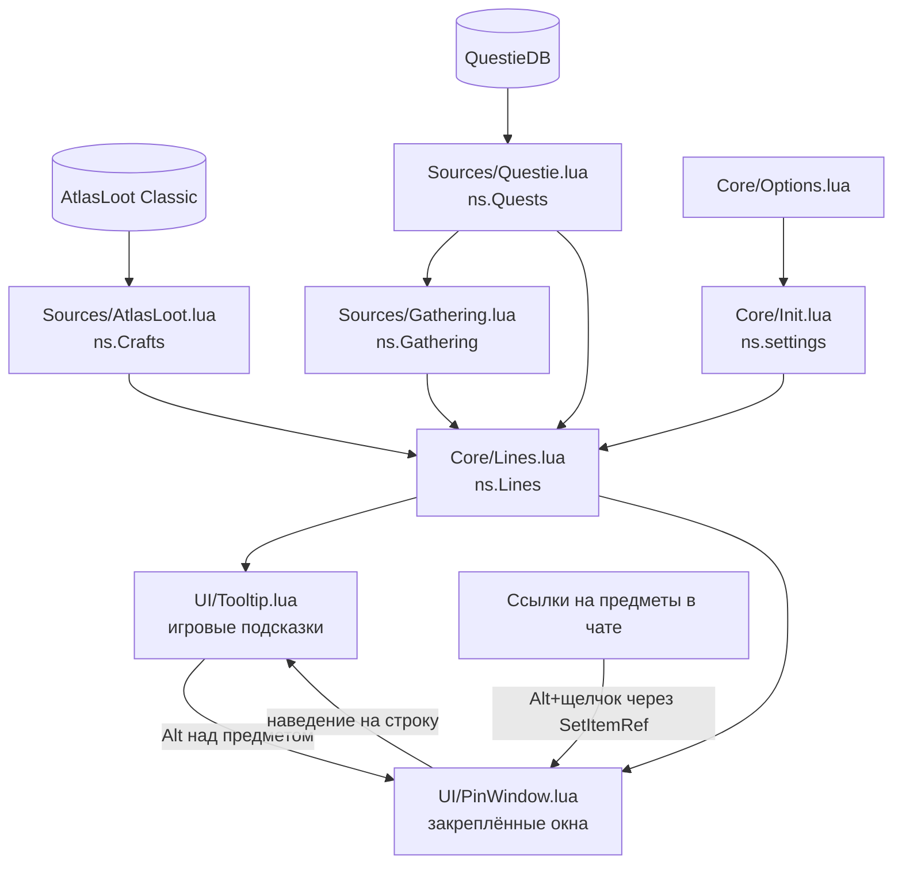
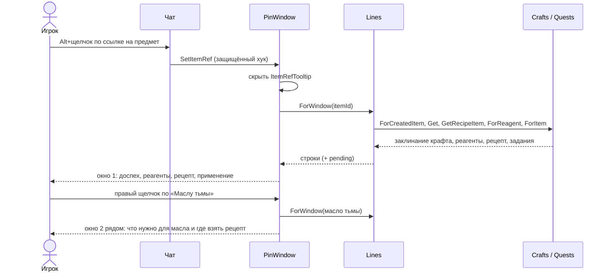

# Архитектура Craft Compass

[English](ARCHITECTURE.md) · **Русский** · [README](../README.ru.md)

Как устроен аддон: откуда берутся данные, как подсказка или закреплённое окно получает свои строки и что происходит
при каждом щелчке. Как настроить репозиторий и запустить проверки, написано в [CONTRIBUTING.md](../CONTRIBUTING.md)
(на английском).

## Принципы

- **Своих данных нет.** Крафты берутся из AtlasLoot Classic (обязателен), задания и источники рецептов — из QuestieDB
  (необязателен, входит в Questie). Оба читаются во время игры. Craft Compass только строит по ним индексы и вызывает
  их открытые функции, поэтому он настолько полон и свеж, насколько полны и свежи они.
- **Всё по id.** Предметы, заклинания, задания, NPC и зоны ищутся по id, а не по названию. Поэтому аддон работает
  на клиенте любого языка: названия приходят от клиента или из QuestieDB на этом языке.
- **Одна модель строк, два способа отрисовки.** Текст собирается один раз в виде списка строк (`Core/Lines.lua`)
  и рисуется либо в игровую подсказку, либо в закреплённое окно.
- **Не подвешивать игру.** Индексы строятся в фоне после входа, понемногу каждый кадр. Если они нужны раньше,
  остаток досчитывается сразу.
- **Названия приходят с опозданием.** У предметов, которых нет в кэше клиента, ещё нет названия. Такие строки
  рисуются как `...`, помечаются *pending* и перерисовываются, когда сервер присылает названия.

## Модули

Файлы загружаются в порядке, указанном в TOC. Каждый — модуль в общем пространстве имён аддона
(`local _, ns = ...`) и может пользоваться только модулями, загруженными раньше него.

| Файл | Модуль | Что делает |
| --- | --- | --- |
| `Libs/Libs.xml` | — | Ace3: LibStub, CallbackHandler, AceGUI, AceConfig (только для панели настроек). |
| `Core/Init.lua` | `ns.L`, `ns.settings`, `ns.OnLogin` | Пространство имён, таблица строк, сохранённые настройки, колбэки входа. |
| `Locales/enUS.lua`, `ruRU.lua` | заполняют `ns.L` | Собственные надписи аддона. Ключ без перевода показывается как есть. |
| `Core/Util.lua` | `ns.Util` | Обёртки над API клиента, `SafeCall`, разбор ссылок, `RunInBackground`. |
| `Sources/AtlasLoot.lua` | `ns.Crafts` | Крафты: реагент → заклинания крафта, предмет → заклинание, предметы-рецепты. |
| `Sources/Questie.lua` | `ns.Quests` | Задания по предмету, названия заданий/NPC/зон, источники предметов, ссылки в чат. |
| `Sources/Gathering.lua` | `ns.Gathering` | Добываемые ресурсы: профессия, навык, зоны трав и жил. |
| `Core/Lines.lua` | `ns.Lines` | Собирает строки: для чего нужен предмет, что нужно для крафта и где его взять. |
| `UI/PinWindow.lua` | `ns.PinWindow` | Закреплённые и вложенные окна, Alt+щелчок в чате. |
| `UI/Tooltip.lua` | `ns.Tooltip` | Хуки подсказок, клавиши-модификаторы, перерисовка при получении названий. |
| `Core/Options.lua` | — | Панель настроек и команды `/craftcompass`, `/ccompass`. |

## Запуск

1. `ADDON_LOADED` для Craft Compass: сохранённая переменная `CraftCompassDB` становится `ns.settings`, а для
   отсутствующих ключей берутся значения по умолчанию (`onlyMyProfessions = false`, `showCompletedQuests = true`).
2. `PLAYER_LOGIN`: по порядку загрузки вызываются все колбэки, зарегистрированные через `ns.OnLogin`. К этому моменту
   загружены все аддоны, включая AtlasLoot и QuestieDB.
   - `Crafts`, `Quests` и `Gathering` начинают строить индексы в фоне, если их аддон-источник установлен.
   - `Tooltip` подключается к `GameTooltip` и `ItemRefTooltip`.
   - `Options` регистрирует панель настроек и команды.

`Util.RunInBackground(work)` запускает `work` как корутину, которую раз в кадр продолжает `C_Timer.NewTicker(0)`.
`work` время от времени уступает управление. Функция возвращает *finish*, которая досчитывает остаток сразу.
`Crafts.ForReagent`, `Crafts.ForCreatedItem`, `Quests.ForItem` и запросы `Gathering` вызывают её первым делом, поэтому подсказка, открытая
сразу после входа, всё равно будет полной.

## Источники данных

### Крафты (`Sources/AtlasLoot.lua`)

AtlasLoot хранит крафты в закрытой таблице и ищет их только по id заклинания:

- `AtlasLoot.Data.Profession.GetProfessionData(spellId)` →
  `{createdItemId, professionId, minSkill, lowSkill, highSkill, reagentIds, reagentCounts, numCreated}`
- `AtlasLoot.Data.Recipe.GetRecipeForSpell(spellId)` → предмет-рецепт или nil, если крафту учит тренер.

Чтобы искать крафты *по предмету*, индекс один раз перебирает id заклинаний от 1 до 400 000 (крафты Classic Era
заканчиваются около 30 000, TBC — около 51 000, а клиент Anniversary добавил несколько около 351 000). Поддерживаемый
форк AtlasLoot держит рецепты Season of Discovery (примерно от 426 000 до 1 232 000) в той же таблице, что и рецепты
Classic Era, поэтому на сервере Season of Discovery (`C_Seasons.GetActiveSeason()`) перебор идёт до 1 300 000, а на
остальных они не попадают в индекс. Он уступает управление каждые 25 000 id; весь проход занимает около 11 мс, на
Season of Discovery — несколько десятков. Получаются две таблицы:

- `spellsByReagent[itemId]` — заклинания крафта, в которые входит предмет;
- `spellByCreatedItem[itemId]` — заклинание, которое создаёт предмет (первое найденное).

Название и значок профессии берутся у закреплённого за каждым id профессии AtlasLoot заклинания (Алхимия →
заклинание 2259 и т. д.), поэтому они на языке клиента.

### Задания (`Sources/Questie.lua`)

QuestieDB отвечает на `LibQuestieDB.<Quest|Item|Npc|Object>.Get(id, field)` и `Quest.GetAllIds()`. Он знает, какие
предметы просит задание, но не знает, какие задания просят предмет, поэтому этот индекс тоже строится в фоне, по 250
заданий за шаг. Предметы берутся из:

- `objectives[3]` — что нужно принести, `{{itemId, text, count}, ...}`;
- `requiredSourceItems` — что должно лежать в сумках для задания.

`Quests.IsForPlayer` проверяет `requiredRaces` и `requiredClasses` — битовые маски с флагом `2^(id-1)`. Они
проверяются арифметикой: в Lua 5.1 нет битовых операторов, а `bit.band` клиента ограничен 32 битами.

Ещё из QuestieDB берётся, откуда появляются предметы (поля `Item`: `vendors` и `questRewards`),
фракция NPC (`friendlyToFaction`: `"A"`, `"H"`, `"AH"`), уровень NPC (`minLevel`, `maxLevel`) и зоны (`zoneID`,
`zoneOrSort`, название — через `C_Map.GetAreaInfo`). У NPC и объекта показывается основная зона, а за ней остальные
зоны из `spawns`: у торговцев Ярмарки Новолуния `zoneID` — Мулгор, но стоят они и в Элвиннском лесу.

Поля добычи (`npcDrops`, `objectDrops`, `itemDrops`) намеренно не используются. Questie заполняет их с Wowhead
только для предметов заданий, остальное взято из базы эмулятора (CMaNGOS) и часто неверно: например, квестовые
мобы разбойников, с которых будто бы падает трава с шансом 21%. Вместо этого окно даёт ссылку на страницу предмета
на Wowhead.

Окно задания читает больше его полей: `objectivesText` (что нужно сделать, QuestieDB переводит его),
`startedBy` и `finishedBy` (`{npcIds, objectIds, itemIds}`), `requiredLevel`, `preQuestSingle` и `preQuestGroup`
(задания перед ним) и `nextQuestInChain`.

Когда загружен и запущен сам Questie (`Questie.started`), через `QuestieLoader:ImportModule` используются два его
модуля: `QuestieLink:CreateQuestTooltip(link, tooltip)` — подсказка строки задания (`Quests.AddQuestieTooltip`), и
`QuestieSearchResults:GetDetailFrame("quest", id)` — окно задания самого Questie (`Quests.OpenInQuestie`). Это не
публичный API Questie, поэтому каждый вызов проверяет, что функция есть, и идёт через `SafeCall`; без них строка
показывает свою короткую подсказку, а в окне нет строки «Открыть в Questie».

Без QuestieDB нет заданий, а предметы и рецепты показываются без источников. Все вызовы чужих аддонов идут через
`Util.SafeCall`, так что изменение их API не ломает подсказки.

### Добыча (`Sources/Gathering.lua`)

Ни AtlasLoot, ни QuestieDB не знают, какой навык нужен для травы, жилы или шкуры, поэтому это единственная
таблица игровых фактов, которую аддон держит у себя:

- `NODES` — травы и жилы по английскому названию: профессия и навык (Снолист → Травничество 270);
- `ITEM_NODES` — из каких из них добывается каждый ресурс (ториевая руда и плотный камень → четыре ториевые жилы);
- `SKINNED` — кожа и шкуры с навыком снятия шкур, с которого звери начинают их давать.

Травы и жилы есть в QuestieDB как объекты с точками появления, но травы там не связаны с предметами, которые
с них падают. Поэтому после входа индекс один раз проходит по всем объектам (по 250 за шаг) и запоминает те, чьё
исходное название (`Object.GetRaw`, английское на любом клиенте) есть в `NODES`. `Gathering.GetZones` суммирует их
точки по зонам и сортирует зоны — сначала те, где точек больше. Сами числа задают только порядок и не
показываются: они из базы эмулятора и с живыми серверами не совпадают. Точки тоже читаются через `GetRaw`: правки
Questie стирают их у 24 самых частых трав и жил (остротерн, медь...), которые он не рисует на карте.

## Модель строк (`Core/Lines.lua`)

Строка — это таблица:

| Поле | Значение |
| --- | --- |
| `text` | левый текст (может содержать значок и ссылку) |
| `color` | `{r, g, b}` левого текста, по умолчанию белый |
| `right`, `rightColor` | правый текст и его цвет (`x4`, `3/4`) |
| `link` | ссылка на предмет или заклинание, которое обозначает строка; в закреплённом окне строка становится кликабельной |
| `open` | список, который щелчок открывает во вложенном окне: `{kind, itemId, label}`, собирает `Lines.ForList` |
| `url` | веб-страница, адрес которой щелчок предлагает скопировать (страница на Wowhead) |
| `action`, `hint` | функция, которую вызывает щелчок, и текст её подсказки («Открыть в Questie») |
| `quest` | id задания, которое обозначает строка |
| `wrap` | переносить длинный текст: в подсказке — по её ширине, в закреплённом окне — по заданной ширине |
| `spacer` | пустая строка между разделами |

Сборщики возвращают `lines, pending`, где `pending` значит, что каких-то названий предметов ещё нет в кэше:

- `Lines.ForItemUses(itemId)` — рецепты, в которые входит предмет, по профессиям (по алфавиту), внутри каждой — по
  навыку, со счётчиком «сколько штук нужно». Затем задания, которые его просят, для этой расы и класса, по уровню,
  выполненные помечены. Оба списка фильтруются настройками. Если ничего нет, ничего и не пишется: источники знают
  не все применения.
- `Lines.ForCraft(spellId)` — профессия и навык, каждый реагент в виде *есть/нужно* (сумки и банк, зелёным — когда
  хватает), затем рецепт: «учитель профессии» или предмет-рецепт с источниками — до двух продавцов (сначала своей
  фракции) и награды за задания, плюс «и ещё N».
- `Lines.ForSources(itemId)` — «где взять»: профессия добычи с навыком и тремя главными зонами, затем продавцы,
  и награды за задания из QuestieDB. В каждом списке два названия и «и ещё N»; названия ищутся только для этих
  двух.
- `Lines.ForList(open)` — весь список за строкой источника: продавцы (чужой фракции — в конце и серым), существа
  с уровнем и зонами, задания или все зоны, начиная с самых богатых.
- `Lines.ForOrigin(itemId)` — `ForCraft` крафта предмета, если он крафтится, а за ним `ForSources`.
- `Lines.ForWindow(itemId)` — для закреплённого окна: `ForOrigin`, затем `ForItemUses`, затем страница предмета на
  Wowhead (`Util.WowheadUrl`: `classic` или `tbc` по версии интерфейса клиента и папка его языка). Реагенты —
  обычные строки со ссылками, поэтому открываются как любой другой предмет.
- `Lines.ForSpellWindow(spellId)` — для закреплённого окна крафта без предмета (чар): описание заклинания,
  `ForCraft` и страница заклинания на Wowhead. Если описания у клиента ещё нет, оно запрашивается (`Util.LoadSpell`),
  и окно перерисовывается, когда оно придёт.
- `Lines.ForQuestWindow(questId)` — для закреплённого окна задания: уровень (и с какого уровня доступно), зона,
  выполнено ли оно или есть в журнале (`Util.IsQuestInLog`), `objectivesText`, кто даёт и кому сдавать, предметы,
  которые нужно принести, — строками предметов с «есть/нужно», задания до и после него — строками заданий, «Открыть
  в Questie», если Questie есть, и страница задания на Wowhead.
- `Lines.AddToTooltip(tooltip, lines)` — рисует строки через `AddLine` / `AddDoubleLine`.

## Подсказки (`UI/Tooltip.lua`)

Клиенты Classic вызывают `OnTooltipSetItem` (`TooltipDataProcessor` в них есть, но не вызывается). Поэтому аддон
подключается к `OnTooltipSetItem` у `GameTooltip` (наведение) и `ItemRefTooltip` (окно предмета, которое открывает
щелчок по ссылке). Подсказки сравнения и прочие не трогаются. `TooltipDataProcessor` используется только на клиенте,
где этого скрипта нет.

Что добавляется:

| Ситуация | Крафт и источники (`ForOrigin`) | Применение (`ForItemUses`) | Прочее |
| --- | --- | --- | --- |
| Наведение без модификаторов | — | — | — |
| Наведение с **Shift** или **Ctrl** | да | да | — |
| Наведение с **Alt** | — | — | открывает первое закреплённое окно |
| Наведение на строку закреплённого окна | да | с Shift | Alt открывает вложенное окно |
| Окно предмета (`ItemRefTooltip`) | да | — | для крафтового предмета подсказка: Alt+щелчок по ссылке закрепит её |

- **Модификаторы:** по `MODIFIER_STATE_CHANGED` снова вызывается `OnEnter` владельца подсказки. Нажали или отпустили
  Shift или Alt над предметом — подсказка перерисовалась без движения мыши.
- **Строки закреплённых окон** несут поле `craftCompassWindow`. Подсказка, у владельца которой оно есть, относится
  к этому закреплённому окну.
- **Чары и заклинания** не проходят через хук предметов. Строка закреплённого окна показывает заклинание по id
  (`SetSpellByID` работает и для чар, где ссылка `spell:`/`enchant:` может не сработать), а
  `Tooltip.AddCraftToSpellTooltip` добавляет его крафт. Alt над такой строкой открывает вложенное окно прямо из
  строки, а `MODIFIER_STATE_CHANGED` перерисовывает и подсказку строки окна, так что Alt можно нажать уже при наведении.

## Закреплённые окна (`UI/PinWindow.lua`)

Окна — фреймы `CraftCompassWindow1`, `CraftCompassWindow2`, … в порядке создания; закрытые переиспользуются. Первое
открывается из подсказки или из чата. Строка окна открывает его вложенное окно: у окна один `child`, который знает
своего `parent` (`WindowFor(parent)` отдаёт ребёнка или привязывает ребёнком свободное окно).

- **Содержимое:** окно показывает предмет или чары (`PinWindow.Show`: `Lines.ForWindow` или `Lines.ForSpellWindow`,
  по ссылке), задание (`PinWindow.OpenQuest`: `Lines.ForQuestWindow`) либо список источников
  (`PinWindow.OpenList`: `Lines.ForList`) — через общий `ShowContent(window, {key, title, titleLink, build})`.
- **Компоновка:** заголовок — сама ссылка на предмет (это тоже строка: на неё можно навести и щёлкнуть), под ним —
  прокручиваемый список строк. Ширина подгоняется под самую длинную строку; строки с `wrap` (источники) занимают
  сверх этого не больше 320 пикселей и переносятся, вырастая в высоту. Высота ограничена 60% экрана, дальше
  список прокручивается (колесом или полосой).
- **Расположение:** первое окно открывается по центру и остаётся там, куда его перетащили. Вложенное окно
  открывается рядом с родительским, с той стороны, где хватает места.
- **Отделение:** перетаскивание вложенного окна отвязывает его от родителя и закрепляет на экране там, где оно есть.
  С родителем оно больше не закрывается, родитель открывает свои строки в новом окне, а своё вложенное окно остаётся
  при нём.
- **Закрытие:** скрытие окна скрывает его ребёнка, так что закрытие окна закрывает всё, что в него вложено, и
  освобождает окно для повторного использования.
  Escape закрывает окна (они в `UISpecialFrames`). Кнопка закрытия вызывает `window:Hide()` напрямую: стандартная
  кнопка закрывает через `HideUIPanel`, а он заблокирован в бою.
- **Тот же предмет ещё раз:** Alt над предметом, который уже показан, оставляет окно как есть (положение, прокрутку,
  вложенные окна).

Что делает строка:

| Действие | Строка предмета или реагента | Строка задания |
| --- | --- | --- |
| Наведение | его подсказка (подсказка предмета с крафтом) | подсказка Questie или название, уровень, зона |
| Щелчок | окно предмета (`SetItemRef`) | вложенное окно задания |
| Shift+щелчок | ссылка в чат | `[Название (id)]` в чат, Questie делает из этого ссылку на задание |
| Правый щелчок, Alt+щелчок, Alt при наведении | вложенное окно | вложенное окно задания |

Строка источника (зоны, продаёт, награда за задание) при наведении показывает подсказку,
а любой щелчок открывает весь список во вложенном окне. Строка Wowhead открывает маленькое собственное окошко
аддона (`CraftCompassCopyDialog`) с адресом, выделенным для Ctrl+C: открыть браузер аддоны не могут, а
`CopyToClipboard` защищена. Это не `StaticPopup`: его фреймы общие для всех попапов, и с широким полем ввода попап
при каждом показе становился чуть шире. У окошка и поля ширина постоянная, а длинный адрес прокручивается внутри
поля. Поле возвращает адрес, если его случайно изменить, а Ctrl+C закрывает окошко в следующем кадре, когда текст
уже скопирован.

Адрес — `https://www.wowhead.com/<раздел>[/<язык>]/<item|spell>=<id>` (`Util.WowheadUrl(kind, id)`):

- **Раздел:** `tbc` для клиента с интерфейсом 20000–29999, `classic` для остальных (Classic Era, Season of Discovery
  и клиент 16001).
- **Язык:** по `GetLocale()`: `deDE` → `de`, `esES` и `esMX` → `es`, `frFR` → `fr`, `itIT` → `it`, `ptBR` → `pt`,
  `ruRU` → `ru`, `koKR` → `ko`, `zhCN` → `cn`. Английские клиенты и языки, которых у Wowhead нет (`zhTW`), получают
  адрес без папки языка — это английская страница.

**Предметы из чата:** `hooksecurefunc("SetItemRef", ...)` видит каждый щелчок по ссылке: в чате, в журнале заданий
и везде, где используется `SetItemRef`. Если при щелчке по ссылке `item:` зажат Alt, аддон открывает её в первом
окне и скрывает окно предмета, открытое щелчком. Защищённый хук выполняется после оригинала и не «портит» его
(taint).

## Названия, которые приходят с опозданием

`GetItemInfo` ничего не возвращает для предметов, которых клиент ещё не видел, и запрашивает их у сервера. Тогда
сборщики помечают свои строки как `pending`:

- закреплённое окно хранит `window.pending`;
- `Tooltip` хранит флаг `pending[tooltip]`, его сбрасывает `OnTooltipCleared`.

По `GET_ITEM_INFO_RECEIVED` (названия приходят пачками, поэтому аддон один раз ждёт 0,2 с, пока придёт вся пачка)
перерисовываются:

- окна с `pending` — на месте: положение, прокрутка и вложенные окна сохраняются;
- подсказка под мышью — повторным входом в её владельца;
- окно предмета — через `SetHyperlink`.

## Пример: предмет из чата

В чате скинули ссылку на кожаный доспех, игрок нажимает на неё с Alt.

## Настройки и тексты

- `ns.settings` берёт отсутствующие значения из значений по умолчанию. `Core/Options.lua` собирает таблицу AceConfig
  из трёх переключателей, добавляет её в настройки игры (раздел «Модификации») и открывает по `/craftcompass` или
  `/ccompass`. Строки собираются при каждом показе, поэтому изменение действует со следующей подсказки.
- Все тексты, которые видит игрок, идут через `ns.L`. `enUS.lua` заполняет его, `ruRU.lua` переопределяет на русском
  клиенте. Названия предметов, заданий, профессий и зон и так приходят на языке клиента.

## Клиенты

Один код, три TOC-файла под разные клиенты:

| TOC | Interface | Клиент |
| --- | --- | --- |
| `CraftCompass_Vanilla.toc` | 11509 | Classic Era 1.15 |
| `CraftCompass_TBC.toc` | 20506 | Burning Crusade Anniversary |
| `CraftCompass.toc` | 16001 | Classic Forever |

Различия API между ними спрятаны в `Util` (`C_Item` / `C_Spell` или глобальные функции).

## Проверки и релизы

- `tools/test.ps1` запускает четыре проверки:
  - `tests/check_syntax.py` — синтаксис всех Lua-файлов;
  - `tools/release_check.py` — версии в трёх TOC и CHANGELOG совпадают;
  - `tests/smoke.py` (enUS и ruRU) — загружает аддон в Lua (lupa) на заглушках клиента, AtlasLoot и QuestieDB
    и проходит подсказки, окна, вложенность, Alt+щелчок в чате и закрытие;
  - `tests/atlasloot_index.py` — строит индекс крафтов по настоящим данным установленного AtlasLoot Classic.
- `.github/workflows/release.yml` — push в `main` с новой `## Version` (и разделом CHANGELOG для неё): прогоняет
  проверки, ставит тег `v<версия>` и собирает zip через BigWigs packager. Zip уходит в GitHub Release, а на
  CurseForge — когда там будет создан проект. `.pkgmeta` не пускает в zip `docs/`, `tests/`, `tools/` и служебные
  файлы репозитория.
- `checks.yml` прогоняет те же проверки на pull request, плюс gitleaks.
